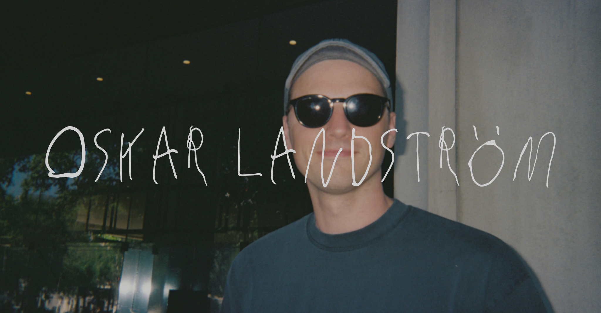

## Front-end Developer

Front-end developer at [Oh My](https://www.ohmy.se/), working with the development and maintenance of CMS-driven websites.

Primarily working with PHP, Blade and Vue, including component-based development, UX and accessibility.

Freelance dancer and performer since 2009, with experience from projects in Sweden and internationally.

## Tech stack

### 💻 Programming

### ⚙️ Development

### 🛠️ Tools & Technologies

### 🎨 Design & Creative Tools

## Currently exploring

AI-assisted development, creative coding, interactive web experiences and animation.

## Get in touch

[🌐 LinkedIn](https://www.linkedin.com/in/oskar-landstrom/)
